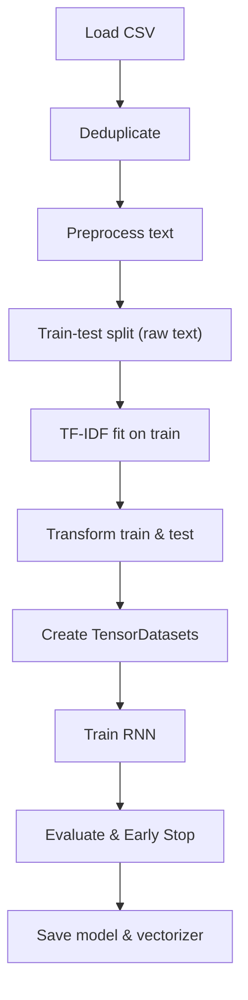

# IMDB_Sentiment_Analysis_RNN

[](https://github.com/fireside4137/IMDB_Sentiment_Analysis_RNN/actions/workflows/ci.yml)
[](https://www.python.org/)
[](https://github.com/psf/black)
[](LICENSE)

A clean, modular educational project demonstrating text preprocessing, TF-IDF feature extraction, and binary sentiment classification using PyTorch.

---

## Table of Contents
- [Overview](#overview)
- [Architecture](#architecture)
- [Dataset](#dataset)
- [Installation](#installation)
- [Training](#training)
- [Inference](#inference)
- [Testing & Quality](#testing--quality)
- [Results](#results)
- [Contributing](#contributing)
- [License](#license)

---

## Overview

The original notebook performed ad-hoc preprocessing steps that introduced several common pitfalls (such as HTML tag removal occurring after punctuation removal, token corruption during stop-word replacement, and data leakage across splits during TF-IDF vectorization). 

This repository refactors the workflow into a robust, modular Python package under `src/` featuring:
- **Leakage-free preprocessing:** Text is split into train and test sets *before* fitting the TF-IDF vectorizer.
- **Robust pipeline:** Strict ordering of HTML stripping, punctuation cleaning, tokenization, stop-word removal, and Porter stemming.
- **Stable loss:** Uses `nn.BCEWithLogitsLoss` without manual sigmoids.
- **Early stopping:** Monitored on validation loss with configurable patience.
- **Device auto-selection:** Automatically leverages CUDA, Apple Silicon MPS, or CPU.
- **Clean inference CLI:** Easy command-line evaluation of arbitrary text.

---

## Architecture



---

## Dataset

This project uses the **IMDB Dataset of 50K Movie Reviews** (binary sentiment: positive / negative).

1. Download `IMDB Dataset.csv` from [Kaggle IMDB Dataset](https://www.kaggle.com/datasets/lakshmi25npathi/imdb-dataset-of-50k-movie-reviews).
2. Place the file in the project root as `IMDB_dataset.csv`.

---

## Installation

Clone the repository:
```bash
git clone https://github.com/fireside4137/IMDB_Sentiment_Analysis_RNN.git
cd IMDB_Sentiment_Analysis_RNN
```

### Option A: Using `venv` (Standard)
```bash
python3 -m venv .venv
source .venv/bin/activate

# Install runtime dependencies
pip install -r requirements.txt

# Install development dependencies (testing & linting)
pip install -r requirements-dev.txt
```

### Option B: Using `conda`
```bash
conda env create -f environment.yml
conda activate imdb_sentiment
```

---

## Training

Train the model and save artifacts to `models/`:

### Using the retrain script
```bash
bash scripts/retrain.sh IMDB_dataset.csv 20 64 5 models
```

### Or using Python directly
```bash
python -m src.train --data IMDB_dataset.csv --epochs 20 --batch-size 64 --patience 5 --output-dir models
```

The script will:
1. Load and clean the dataset.
2. Fit the TF-IDF vectorizer on training data only.
3. Automatically select the best hardware accelerator (CUDA / MPS / CPU).
4. Train the RNN and track validation metrics.
5. Stop early when validation loss plateaus.
6. Save the trained weights to `models/rnn_model.pt` and vectorizer to `models/tfidf_vectorizer.pkl`.

---

## Inference

Run sentiment inference on any text review:

```bash
python -m src.infer "The cinematography and acting in this film were absolutely breathtaking!"
```

Output:
```text
Sentiment:  POSITIVE
Confidence: 94.12% (prob=0.9412)
```

Negative review example:
```bash
python -m src.infer "The plot was incoherent and the pacing felt dragged out."
```

Output:
```text
Sentiment:  NEGATIVE
Confidence: 89.30% (prob=0.1070)
```

---

## Testing & Quality

All code adheres to strict linting, formatting, and typing standards:

```bash
# Code formatting
black --check src tests
isort --check src tests

# Style checking
flake8 src tests

# Static type verification
mypy src tests

# Run unit tests and generate coverage report
pytest --cov=src --cov-report=term
```

---

## Results

On the standard 50,000 IMDB review benchmark:
- **Accuracy:** ~85.6%
- **Evaluation:** Precision, Recall, and F1 scores are tracked and logged per epoch.

> **Note:** This model uses a single-step recurrent layer over TF-IDF vectors for educational clarity. For state-of-the-art NLP performance, sequential token embeddings with LSTMs, GRUs, or Transformer-based architectures (e.g., DistilBERT) are recommended next steps.

---

## Contributing

Contributions, bug reports, and pull requests are welcome! See [CONTRIBUTING.md](CONTRIBUTING.md) for contribution guidelines and environment setup.

---

## License

This project is licensed under the MIT License - see the [LICENSE](LICENSE) file for details.
