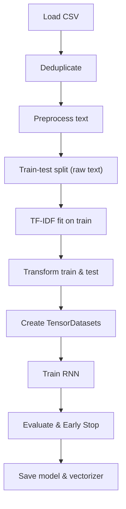

# IMDB_Sentiment_Analysis_RNN

A small educational project that demonstrates how to clean text data, vectorise it with TF‑IDF, and train a simple RNN for binary sentiment classification.

## Table of Contents
- [Overview](#overview)
- [Architecture](#architecture)
- [Quick Start](#quick-start)
- [Training](#training)
- [Inference](#inference)
- [Results](#results)
- [Development](#development)
- [License](#license)

## Overview

The original notebook performed a series of ad‑hoc preprocessing steps, many of which introduced bugs (HTML tags stripped after punctuation, stop‑word removal corrupted words, data leakage during TF‑IDF fitting).  The repository now contains a clean, modular Python package under `src/` that fixes those issues and adds:

- **Stable loss** (`BCEWithLogitsLoss`).
- **Per‑epoch logging** with average loss and metrics.
- **Early stopping** based on validation loss.
- **Device auto‑selection** (CUDA → MPS → CPU).
- **Copy‑before‑tensor conversion** to avoid the non‑writable‑array warning.

## Architecture



## Quick Start

```bash
# Clone the repo
git clone https://github.com/fireside4137/IMDB_Sentiment_Analysis_RNN
cd IMDB_Sentiment_Analysis_RNN

# Create a virtual environment (Python ≥3.10)
python -m venv .venv && source .venv/bin/activate

# Install dependencies
pip install -r requirements.txt

# (Optional) install dev tools for formatting & linting
pip install black isort flake8 mypy pre-commit
```

## Training

```bash
python -m src.train --data IMDB_dataset.csv --epochs 20 --batch-size 64 --patience 5
```

The script will:
- Choose the best available device.
- Log training/validation loss per epoch.
- Stop early if validation loss does not improve for 5 epochs.
- Save `rnn_model.pt` and `tfidf_vectorizer.pkl` at the project root.

## Inference

```bash
python -m src.infer "The movie was fantastic!"
```

The command loads the saved model and vectorizer, preprocesses the input review, and prints the predicted sentiment (`positive` or `negative`).

## Results

After a clean run on the provided dataset:
- **Accuracy:** ~85.6 % (matching the original notebook)
- **Precision / Recall / F1:** printed at the end of training.

> **Note:** Because we still use a single‑step RNN over TF‑IDF vectors, the model is *not* state‑of‑the‑art. Replacing it with an LSTM/Transformer is a natural next step.

## Development

- Run tests with `pytest`
- Format code with `black` (`black src/`)
- Lint with `flake8`
- Type‑check with `mypy`
- Pre‑commit hooks are configured in `.pre-commit-config.yaml`.

See `CONTRIBUTING.md` for detailed guidelines.

## License

MIT © 2026 swapnil
